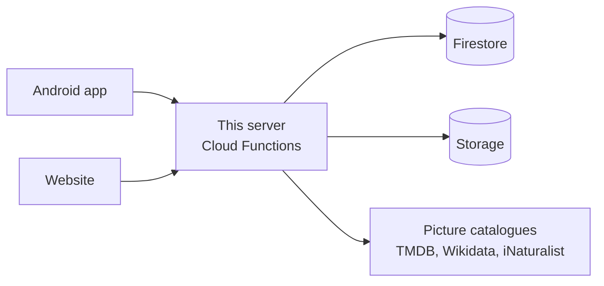

<h1 align="center">TierYourLife: the server</h1>

  <b>The one door between the apps and the data.</b> 
  The backend of <a href="https://github.com/kellygracelab-dotcom/TierYourLife">TierYourLife</a>, a tier list maker for
  <a href="https://tieryourlife.com">the web</a> and Android.

Neither app talks to the database or holds a catalogue key. They ask this server, and it decides.

## What it does

- **The community.** Publishing a list, the feed, sections and topics, everyone's rankings of one list, follows, reports and moderation.
- **Lists kept in an account,** so they follow a person to a new phone and to the website.
- **Pictures.** Search by name across the catalogues, copies kept in our own storage, small versions for cards.
- **Keys and limits.** The apps never carry a catalogue key, and every costly action is counted here.

## Read next

- [CONTRACT.md](CONTRACT.md): the API both apps follow. Start here.
- [Why it is built this way](docs/design.md): credits, quotas, kept boards and pictures, with the reasoning.
- [RESTORE.md](RESTORE.md): how the database is protected and restored.
- [AGENTS.md](AGENTS.md): how a change is checked and released.

Cloud Functions on Node 22 in TypeScript, Firestore, Storage and App Check, in `europe-west1`.

## Three repositories

| | Repository | Where it runs |
|---|---|---|
| **Server** | this one | behind both apps |
| **Android app** | [TierYourLife](https://github.com/kellygracelab-dotcom/TierYourLife): Kotlin, Jetpack Compose | Google Play, in closed testing |
| **Website** | [tieryourlife-web](https://github.com/kellygracelab-dotcom/tieryourlife-web): React, TypeScript | [tieryourlife.com](https://tieryourlife.com) |

## License

The code is licensed under the [GNU Affero General Public License v3.0](LICENSE) (AGPL-3.0). © 2026 Artiuillab.

The license covers the code only. The TierYourLife name, the logo and the pictures are not covered by it.
